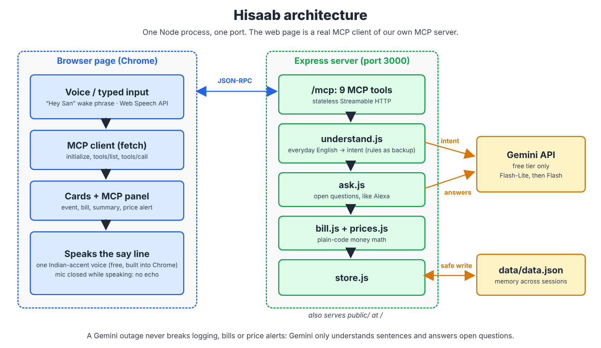

# Hisaab

Hisaab is an Alexa+ style voice assistant that keeps your home's money memory. Say **"Hey San"** and tell it who came,
who didn't, what you paid and what you bought — at month-end it knows exactly what you owe, and it warns you when
the vegetable seller is overcharging you.

**Demo video:** _add YouTube link here_

## Features

- **Helpers ledger:** log the maid, cook, milkman and newspaper as it happens, in everyday English
  ("Shanti didn't come today", "the milkman gave half a litre extra", "I gave Lakshmi 1000 rupees advance last Friday").
  Ask "How much do I owe everyone this month?" for a bill card per helper and a ready-to-send WhatsApp message.
- **Price memory:** log purchases ("Tomatoes 40 rupees a kilo from the corner shop"). Hisaab learns the usual price
  per item and vendor and warns you when something costs too much, naming the cheaper vendor.
- **Ask anything:** like Alexa, it answers open questions ("How much did I spend on vegetables?", "Who was absent the
  most?", or anything general) — household questions are answered only from your own records.
- **Hands-free voice:** say **"Hey San"** to talk. After Hisaab asks you something, the mic stays open for a moment so
  you can just answer. It speaks every reply in one Indian-accent voice, and keeps its mic closed while talking.
- **Understands people, not commands:** casual phrasing, misheard names, dates like "yesterday", "last Monday" or
  "on 10th October", and sensible defaults (a cook is paid monthly, a milkman per litre).
- **Safe by design:** the same absence can't be logged twice, every entry has its own **Undo**, and all money maths is
  plain code — never the AI.
- **Memory across sessions:** everything is stored in `data/data.json`, so numbers survive a server restart.
- **Real MCP:** the web page is a real MCP client calling 9 tools over Streamable HTTP; **Under the hood** shows
  every request and response live.

## Language

English, including Indian English and everyday phrasing. (Hindi and Tamil are on the roadmap: adding a language is
one block of reply templates in `src/lang.js` plus a speech language code — no model training needed.)

## Setup

You need **Node 20 or newer** (`node -v` must print v20+) and **Chrome** (or Edge) for the microphone.

```bash
git clone https://github.com/tan1sh13/Hisaab.git
cd Hisaab
npm install
cp .env.example .env      # then add your free Gemini key (see below)
npm run seed              # loads the demo data
npm start
```

Open http://localhost:3000 in Chrome and allow the microphone once. Always use `http://localhost:3000`, not `file://`.

`.env` contents:

```
GEMINI_API_KEY=your_key_from_aistudio.google.com
PORT=3000
```

`npm run seed` resets the demo at any time (October 2026 data). The date next to the logo is the date Hisaab treats as
"today" — the real date by default; for the demo video set **Under the hood → Today is** to 31 Oct 2026 so the bills
cover the whole month. Without a Gemini key the app still works: logging, bills and price alerts use built-in rules.

## Using it

1. Say **"Hey San"** (the mic lights up), then say what happened — or say it in one go: "Hey San, Shanti didn't come today".
2. Or type in the box and press Enter, or tap the mic.
3. Things to try: "Tomatoes 40 rupees a kilo from the corner shop" (red price alert), "How much do I owe everyone this
   month?", "What is Shanti's bill?", "Add Meena as a cook for 5000 a month", "Undo the last entry",
   "How much did I spend on vegetables this month?"

## Everything is free

- **Gemini (free tier only):** `gemini-3.8-flash-lite` first (about 500 requests/day), then `gemini-3.8-flash`
  (about 20/day). When one runs out of free quota, Hisaab moves to the other. Keep the key's Google project **without
  billing** and it can never be charged.
- **Voice:** the browser's built-in speech recognition and an Indian-accent voice built into Chrome — no paid service.
  (An optional Gemini voice exists under **Under the hood → Voice**, but its free quota is only a few replies a day.)

## Getting a free Gemini key

1. Go to https://aistudio.google.com and sign in with a Google account.
2. Choose **Get API key** and create a key.
3. Paste it into `.env` as `GEMINI_API_KEY`. (Optional: `GEMINI_MODEL` adds one more free model to try.)

The key stays on the server in `.env`. It is never sent to the browser and never committed.

## Architecture



One Node process on one port serves both the web page and the MCP server. Gemini is used only to understand sentences
(`understand`) and to answer open questions (`ask`), so an outage never breaks logging, bills or price alerts. All money
maths is plain code.

```
Browser page                        Express server, one port
 mic / typed input   -- JSON-RPC -->  /mcp : 9 MCP tools (stateless)
 MCP client (fetch)  <--------------    |- understand.js + ask.js --> Gemini API (free tier)
 cards + MCP panel                      |- bill.js + prices.js
 speaks the say line                    `- store.js --> data/data.json
                                     /  : serves public/
```

## MCP tools

Every tool also accepts an optional `lang` (`en`) and returns a `say` line that the page speaks.

| Tool | Input | Output |
| --- | --- | --- |
| `understand` | `text`, `date?` | `{ intent, args, source, say? }` |
| `add_helper` | `name, rate, role?, rateType?, unit?, paidLeaves?, defaultQtyPerDay?` | `{ helper, say }` |
| `log_helper_event` | `helper`, `type`, `qty?`, `amount?`, `date?`, `today?`, `raw` | `{ event, helperName, duplicate?, say }` |
| `get_bill` | `helper?`, `month` (`YYYY-MM`) | `{ bills, say }` |
| `month_summary` | `month` | `{ bills, total, whatsapp, say }` |
| `log_purchase` | `item, vendor, price, unit, qty?, date?, raw` | `{ purchase, alert, say }` |
| `price_check` | `item`, `vendor?` | `{ item, avg, min, max, cheapestVendor, lastPrices, say }` |
| `undo_last` | `id?`, `kind?` (none = newest entry) | `{ removed, kind, say }` |
| `ask` | `question`, `date?`, `previous?` | `{ answer, source, say }` |

## Testing with MCP Inspector

With the server running:

```bash
npx @modelcontextprotocol/inspector
```

Choose transport **Streamable HTTP** and URL `http://localhost:3000/mcp`, then connect and try `tools/list`.

Unit tests (bills, prices, parser, dates, voice text, Gemini fallbacks): `npm test`.

## License

MIT, see [LICENSE](LICENSE).

## Team

Dharmik, Ritu, Tanish and MBS, built for the Build, Ship, Shape: Amazon Developer Hackathon (Alexa+ track).

Problems we hit while building, with fixes: [docs/friction-log.md](docs/friction-log.md).
